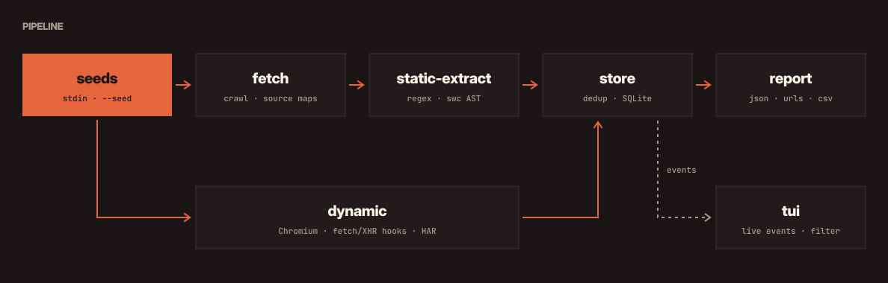
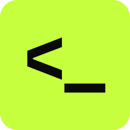

<p align="center">
  
</p>

<p align="center">
  <a href="https://github.com/MikeRoss27/WebRev/actions/workflows/ci.yml"></a>
  
  
  
</p>

<p align="center">
  <a href="#features">Features</a> ·
  <a href="#install">Install</a> ·
  <a href="#quick-start">Quick start</a> ·
  <a href="#pipeline-native">Pipelines</a> ·
  <a href="#how-it-works">How it works</a> ·
  <a href="#documentation">Docs</a>
</p>

<br>

**webrev** maps what a web front end gives away. It crawls in scope, pulls
endpoints, parameters, routes, GraphQL operations, source maps and secrets out
of HTML and JavaScript, fingerprints the stack, and can drive a headless
Chromium to capture live traffic. Results land in SQLite and come back out
as JSON, URLs or CSV, ready for your next tool. One Rust binary, a CLI and a TUI.

> [!WARNING]
> **Authorized targets only.** The scope is fail-closed and secrets are stored
> as non-reversible fingerprints, but staying within the bounds of your
> engagement is on you. Read [docs/security.md](docs/security.md) first.

## Features

<table>
  <tr>
    <td width="50%" valign="top">
      <br>
      <b>Bounded crawler</b><br>
      Breadth-first, scope-restricted, with <code>--max-pages</code>, <code>--max-depth</code>, <code>--max-concurrency</code> budgets and request jitter.
    </td>
    <td width="50%" valign="top">
      <br>
      <b>Static extraction</b><br>
      HTML, JavaScript via regex <i>and</i> <code>swc</code> AST (<code>fetch</code>, <code>axios</code>, <code>XHR</code>, <code>WebSocket</code>), SPA routes, GraphQL, params. <code>/users/123</code> → <code>/users/{id}</code>.
    </td>
  </tr>
  <tr>
    <td valign="top">
      <br>
      <b>Source-map recovery</b><br>
      Fetches and parses <code>.map</code> files to re-mine the original, un-minified source for hidden endpoints and secrets.
    </td>
    <td valign="top">
      <br>
      <b>Secret detection</b><br>
      Known credential shapes plus Shannon-entropy heuristics. Every secret is stored as a truncated HMAC fingerprint, never in plaintext.
    </td>
  </tr>
  <tr>
    <td valign="top">
      <br>
      <b>Stack fingerprinting</b><br>
      Frameworks (Next.js, React, Vue, Angular…), BaaS / DB (Supabase, Firebase, Hasura, Cognito…) and servers (nginx, Express, Laravel, Rails…).
    </td>
    <td valign="top">
      <br>
      <b>Dynamic analysis</b><br>
      Headless Chromium with injected <code>fetch</code>/XHR hooks, HAR capture, active SPA interaction (scroll + click) and WebSocket capture.
    </td>
  </tr>
  <tr>
    <td valign="top">
      <br>
      <b>Authenticated scans</b><br>
      Cookies, headers and bearer tokens applied to both the HTTP client and the browser. Works through an intercepting proxy.
    </td>
    <td valign="top">
      <br>
      <b>Live TUI</b><br>
      Endpoints / Findings / Logs / Status tabs streaming pipeline events, <code>/</code> filtering, severity sort, internal / external tagging.
    </td>
  </tr>
  <tr>
    <td valign="top">
      <br>
      <b>Pipeline-native</b><br>
      Seeds from stdin, reports as <code>json</code>, <code>jsonl</code>, <code>urls</code> or <code>csv</code>. Data on stdout, chatter on stderr, closed pipes exit cleanly.
    </td>
    <td valign="top">
      <br>
      <b>Fail-closed scope</b><br>
      Host-suffix include / exclude lists. An empty include list denies everything, so nothing leaves the engagement by accident.
    </td>
  </tr>
</table>

## Install

Requires a recent stable Rust toolchain (edition 2021, Rust ≥ 1.82) and a C
compiler. SQLite and the TLS backend (rustls / ring) are built from source, so
no system OpenSSL or libsqlite3 is needed. Dynamic analysis also needs a local
Chrome / Chromium.

```bash
git clone https://github.com/MikeRoss27/WebRev.git && cd WebRev
cargo build --release        # → target/release/webrev and webrev-tui
```

<details>
<summary><b>Linux / Arch Linux</b></summary>

<br>

Fully supported: the only build requirement beyond Rust is a C toolchain.

```bash
# Arch Linux
sudo pacman -S --needed rustup base-devel   # Rust + gcc
sudo pacman -S chromium                      # only for `webrev dynamic` / TUI `d`

# Debian / Ubuntu: build-essential + chromium (or chromium-browser)
```

Chromium is auto-detected on `PATH` (`chromium`, `chromium-browser`,
`google-chrome-stable`, …). For a Flatpak / Snap or custom install, point
webrev at the binary:

```bash
CHROME=/usr/bin/chromium webrev dynamic --seed https://app.example.com/
```

</details>

<details>
<summary><b>Development</b></summary>

<br>

```bash
cargo test --workspace                                 # browser tests are #[ignore]
cargo clippy --workspace --all-targets -- -D warnings
```

</details>

## Quick start

```console
$ webrev scan --seed https://app.example.com/

   <_   webrev 0.1.0
        web reconnaissance toolkit · authorized targets only
```

```bash
# One shot: static crawl + report (add --dynamic for a headless pass)
webrev scan --seed https://app.example.com/

# Step by step, with budgets
webrev static --seed https://app.example.com/ --max-depth 2 --max-pages 200
webrev report --output report.json

# Authenticated, through an intercepting proxy
webrev static --seed https://app.example.com/ \
  --cookie "session=…" --header "X-Env: staging" --proxy http://127.0.0.1:8080

# Interactive TUI (auto-starts a static scan · s / d / r / Tab / q)
webrev tui --seed https://app.example.com/
```

## Pipeline-native

webrev sits in the middle of a recon chain: seeds come in on stdin, results go
out on stdout, and the banner and logs stay on stderr.

```bash
# Subdomains in, findings stored
subfinder -d example.com | httpx -silent | webrev static --scope example.com

# In-scope endpoint URLs out, straight into a fuzzer or scanner
webrev report --format urls --scope internal | ffuf -u FUZZ -w -
webrev report --format urls --scope internal | nuclei

# High-severity findings as a spreadsheet
webrev report --format csv --min-severity high --output findings.csv
```

## How it works

<p align="center">
  
</p>

Each stage runs in its own tokio task, joined by bounded channels. Extraction is
pure and network-free; the browser path writes its findings straight to the same
store. A Cargo workspace keeps the layers honest:

| Crate | Role |
| --- | --- |
| `webrev-core` | Domain model, errors, sanitize / opsec / auth, URL normalization |
| `webrev-extract` | Pure, synchronous extractors + priority registry (zero I/O) |
| `webrev-storage` | `Storage` port + SQLite and in-memory backends |
| `webrev-pipeline` | tokio stage pipeline: fetch → static-extract → store |
| `webrev-browser` | chromiumoxide: profile, pool, hooks, HAR, dynamic run |
| `webrev-report` | JSON report + summary counters |
| `webrev-cli` | The `webrev` binary (clap subcommands) |
| `webrev-tui` | The `webrev-tui` binary + library (ratatui) |

## Documentation

| | Doc | What it covers |
| --- | --- | --- |
|  | [docs/usage.md](docs/usage.md) | Commands, flags, env vars, TUI keys, worked examples |
|  | [docs/architecture.md](docs/architecture.md) | Workspace layout, crate responsibilities, pipeline data flow |
|  | [docs/extractors.md](docs/extractors.md) | The extractor catalog, finding kinds, adding your own |
|  | [docs/security.md](docs/security.md) | Authorization, scope, secret handling, responsible use |

## Brand

Logo, icons and diagrams live in [docs/assets/](docs/assets/): outlined SVGs with
no font dependency. The mark is `<_`, set in
[Martian Mono](https://github.com/evilmartians/mono) (OFL): *reverse*, and the
prompt waiting for the next command. Palette: void `#0A0A0A`, bone `#EDEDE6`,
acid `#C6FF3D`, alert `#FF5A36`.

## License

MIT. See the individual crate manifests.

<br>

<p align="center">
  
  <br>
  <sub>authorized targets only</sub>
</p>
