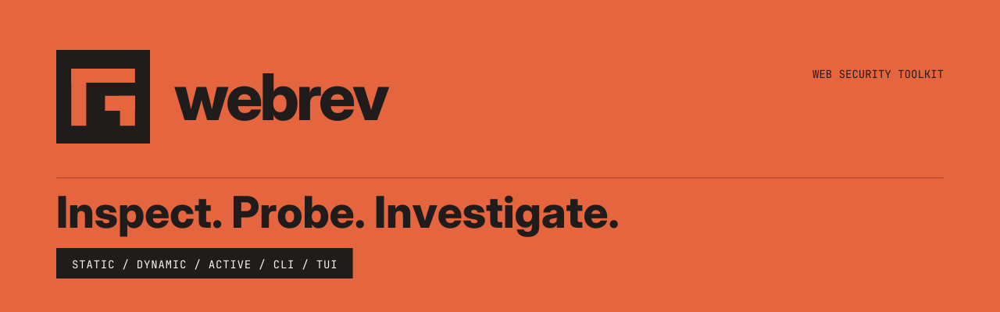

<p align="center">
  
</p>

<p align="center">
  <a href="https://github.com/MikeRoss27/WebRev/actions/workflows/ci.yml"></a>
  
  
  
</p>

<p align="center">
  <a href="#features">Features</a> ·
  <a href="#install">Install</a> ·
  <a href="#quick-start">Quick start</a> ·
  <a href="#pipeline-native">Pipelines</a> ·
  <a href="#how-it-works">How it works</a> ·
  <a href="#documentation">Docs</a>
</p>

<br>

**webrev** is a **web security analysis and testing toolkit** for application
assessment, reverse engineering and penetration testing. It combines static code
inspection, dynamic browser investigation and scoped active security probes.

Discover APIs, routes, parameters, GraphQL operations, source maps, credentials
and the technology stack. Investigate HTTP and WebSocket traffic, trace calls to
browser interactions, and probe access controls, CORS, redirects, exposed files
and injection signals. Findings carry severity, confidence, evidence and source
locations for triage in the CLI, TUI or structured reports.

Sessions stay in memory; export JSON, JSONL, CSV, URLs or readable text when
needed. The default `scan` runs static analysis; `--dynamic` adds browser-driven
investigation and `--active` adds security probes. The TUI exposes all three modes.

> [!WARNING]
> **Authorized targets only.** The scope is fail-closed. Detected secrets are shown
> in plaintext in the TUI and reports. Staying within the bounds of your
> engagement is on you. Read [docs/security.md](docs/security.md) first.

## Features

<table>
  <tr>
    <td width="50%" valign="top">
      <br>
      <b>Bounded crawler</b><br>
      Breadth-first, scope-restricted, with <code>--max-pages</code>, <code>--max-depth</code>, <code>--max-concurrency</code> budgets and request jitter.
    </td>
    <td width="50%" valign="top">
      <br>
      <b>Static extraction</b><br>
      HTML, JavaScript via regex <i>and</i> <code>swc</code> AST (<code>fetch</code>, <code>axios</code>, <code>XHR</code>, <code>WebSocket</code>), SPA routes, GraphQL, params. <code>/users/123</code> → <code>/users/{id}</code>.
    </td>
  </tr>
  <tr>
    <td valign="top">
      <br>
      <b>Source-map recovery</b><br>
      Fetches and parses <code>.map</code> files to re-mine the original, un-minified source for hidden endpoints and secrets.
    </td>
    <td valign="top">
      <br>
      <b>Secret detection</b><br>
      Known credential shapes plus Shannon-entropy heuristics. Detected secrets are visible in plaintext by default, with fingerprints for deduplication.
    </td>
  </tr>
  <tr>
    <td valign="top">
      <br>
      <b>Stack fingerprinting</b><br>
      Frameworks (Next.js, React, Vue, Angular…), BaaS / DB (Supabase, Firebase, Hasura, Cognito…) and servers (nginx, Express, Laravel, Rails…).
    </td>
    <td valign="top">
      <br>
      <b>Dynamic analysis</b><br>
      Headless Chromium with injected <code>fetch</code>/XHR hooks, HAR capture, active SPA interaction (scroll + click) and WebSocket capture.
    </td>
  </tr>
  <tr>
    <td valign="top">
      <br>
      <b>Authenticated scans</b><br>
      Cookies, headers and bearer tokens applied to both the HTTP client and the browser. Works through an intercepting proxy.
    </td>
    <td valign="top">
      <br>
      <b>Live TUI</b><br>
      Endpoints / Findings / Vulns / Secrets / Tech / Logs / Status tabs streaming pipeline events, <code>/</code> filtering, severity sort, internal / external tagging.
    </td>
  </tr>
  <tr>
    <td valign="top">
      <br>
      <b>Pipeline-native</b><br>
      Seeds from stdin, reports as <code>json</code>, <code>jsonl</code>, <code>urls</code> or <code>csv</code>, a readable <code>text</code> triage view, plus an <code>openapi</code> spec reconstructed from the discovered surface. Data on stdout, chatter on stderr, closed pipes exit cleanly.
    </td>
    <td valign="top">
      <br>
      <b>Fail-closed scope</b><br>
      Host-suffix include / exclude lists. An empty include list denies everything, so nothing leaves the engagement by accident.
    </td>
  </tr>
  <tr>
    <td valign="top" colspan="2">
      <br>
      <b>Deeper static analysis</b><br>
      Exposed cloud buckets (S3 / GCS / Azure Blob), decoded JWTs (flags <code>alg:none</code> / <code>alg:HS*</code>) and bearer/storage tokens, client-side XSS by lightweight source→sink taint over DOM sinks, passive CSP / security-header policy review, and "ghost" endpoints hidden behind client-side role or feature-flag gates.
    </td>
  </tr>
  <tr>
    <td valign="top" colspan="2">
      <br>
      <b>Active scanning</b> (<code>--active</code>, opt-in)<br>
      Light, capped vulnerability probing over discovered endpoints: missing security headers, cookie flags, credentialed CORS, content-verified sensitive files, open redirects, per-parameter SQL/XSS signals, differential template arithmetic, auth-free (IDOR-lite) access checks, content-verified path traversal/LFI, CRLF, SSRF and prototype-pollution signals, GraphQL introspection, and per-origin subdomain-takeover fingerprinting. Every attempt consumes the shared request budget; reports include proof tiers and actual coverage. Sends abnormal traffic — authorized targets only.
    </td>
  </tr>
</table>

## Install

From a checkout, one command builds and installs **both** the CLI and TUI:

```powershell
# Windows (Rust 1.89+, Visual Studio C++ tools, CMake)
./scripts/install.ps1
```

```sh
# Linux/macOS (Rust 1.89+, C compiler, CMake)
sh scripts/install.sh
```

Already built? Add `-BinaryDir ./target/release` on Windows or
`--binary-dir ./target/release` on Unix. Downloaded portable bundles use the same
scripts without a compiler and verify their SHA-256 checksums. The
`Portable bundles` workflow prepares Windows/Linux/macOS artifacts; these are
not yet published releases. See [installation and troubleshooting](docs/installation.md).

Chromium/Chrome is needed only for dynamic analysis. `CHROME` can point to its
executable. Static/active HTTP scans work without it.

## Quick start

```console
$ webrev scan --seed https://app.example.com/

  █████████████████
  █████████████████                   ██
  ████                ▄▄    ▄▄  ▄▄▄▄  ██▄▄▄  ▄▄ ▄▄▄  ▄▄▄▄  ▄▄    ▄▄
  ████     ▄▄▄▄▄▄▄▄   ██ ▄▄ ██ ██▄▄██ ██  ██ ██▀    ██▄▄██ ▀█▄  ▄█▀
  ████     ████████   ██▄██▄██ ██  ▄▄ ██  ██ ██     ██  ▄▄  ▀█▄▄█▀
  ████     ▀▀▀▀████    ▀▀  ▀▀   ▀▀▀▀  ▀▀▀▀▀  ▀▀      ▀▀▀▀     ▀▀
  ████         ████   web security toolkit · v0.1.0
  ████         ████   authorized targets only
```

```bash
# Application assessment: static + browser investigation + active probes
webrev scan --seed https://app.example.com/ --dynamic --active

# Static inspection + report
webrev scan --seed https://app.example.com/

# Console triage: discard the session without writing a report
webrev scan --seed https://app.example.com/ --no-report

# Step by step, with budgets
webrev static --seed https://app.example.com/ --max-depth 2 --max-pages 200
webrev report --output report.json

# Authenticated, through an intercepting proxy
webrev scan --seed https://app.example.com/ --dynamic --active \
  --cookie "session=…" --header "X-Env: staging" --proxy http://127.0.0.1:8080

# Light active probing over discovered endpoints (opt-in, abnormal traffic)
webrev scan --seed https://app.example.com/ --active

# Interactive TUI (auto-starts static analysis · s / d / a / r / Tab / q)
webrev tui --seed https://app.example.com/
```

Scans show grouped vulnerabilities, full secrets, technologies and attack surface,
with severity, confidence, evidence and source URLs. The TUI has focused Secrets,
Vulns and Tech tabs; `a` launches active checks, `Enter` opens scrollable evidence.
IDOR/XSS/SQLi signals need manual verification. SSTI arithmetic uses two calculated
results and a payload-free control; OS RCE remains untested. Probe observations
and incomplete coverage are visible in reports and TUI details. See the
[research review](docs/active-research.md).

```sh
webrev report --format text                    # inspect a saved JSON report
webrev scan --seed https://app.example.com/ --format jsonl --report - | jq .
```

## Pipeline-native

webrev fits into a security testing toolchain: seeds come in on stdin, results go
out on stdout, and the banner and logs stay on stderr.

```bash
# Subdomains in, static inspection results as JSON Lines on stdout
subfinder -d example.com | httpx -silent | webrev scan --scope example.com --format jsonl --report -

# In-scope endpoint URLs out, straight into a fuzzer or scanner
webrev report --format urls --scope internal | ffuf -u FUZZ -w -
webrev report --format urls --scope internal | nuclei

# High-severity findings as a spreadsheet
webrev report --format csv --min-severity high --output findings.csv
```

## How it works

<p align="center">
  
</p>

Each stage runs in its own tokio task, joined by bounded channels. Extraction is
pure and network-free; the browser path writes its findings straight to the same
store. A Cargo workspace keeps the layers honest:

| Crate | Role |
| --- | --- |
| `webrev-core` | Domain model, errors, sanitize / opsec / auth, URL normalization |
| `webrev-extract` | Pure, synchronous extractors + priority registry (zero I/O) |
| `webrev-storage` | `Storage` port + process-local in-memory sessions |
| `webrev-pipeline` | Crawl, static analysis, active security probes and in-memory storage |
| `webrev-browser` | Browser interaction, request hooks, HAR and WebSocket capture |
| `webrev-report` | JSON/JSONL/CSV/URL exports, grouped text triage + counters |
| `webrev-cli` | The `webrev` binary (clap subcommands) |
| `webrev-tui` | The `webrev-tui` binary + library (ratatui) |

## Documentation

| | Doc | What it covers |
| --- | --- | --- |
|  | [docs/installation.md](docs/installation.md) | One-command install, portable bundles, build prerequisites |
|  | [docs/usage.md](docs/usage.md) | Commands, flags, env vars, TUI keys, worked examples |
|  | [docs/architecture.md](docs/architecture.md) | Workspace layout, crate responsibilities, pipeline data flow |
|  | [docs/extractors.md](docs/extractors.md) | The extractor catalog, finding kinds, adding your own |
|  | [docs/security.md](docs/security.md) | Authorization, scope, secret handling, responsible use |

## Brand

**Web security toolkit · Inspect. Probe. Investigate.** Static inspection, dynamic
browser investigation and active security testing share the same visual identity.
See [positioning and asset regeneration](docs/branding.md).

Logo, icons and diagrams live in [docs/assets/](docs/assets/): authored SVGs, text
outlined, no font dependency. The symbol is a blocky geometric "shifted tool",
set with [Inter](https://rsms.me/inter/) (OFL) for the wordmark and
[JetBrains Mono](https://www.jetbrains.com/lp/mono/) (OFL) for labels. Palette:
orange `#E5653F`, ink `#211C1C`, cream `#FAF4E8`. Orange is the one signal color,
used for the mark, the active tab and live state. The terminal banner and the
TUI empty state are drawn in half-block characters from
[`crates/webrev-tui/src/brand.rs`](crates/webrev-tui/src/brand.rs), which also
holds the palette.

## License

MIT. See the individual crate manifests.

<br>

<p align="center">
  
  <br>
  <sub>authorized targets only</sub>
</p>
